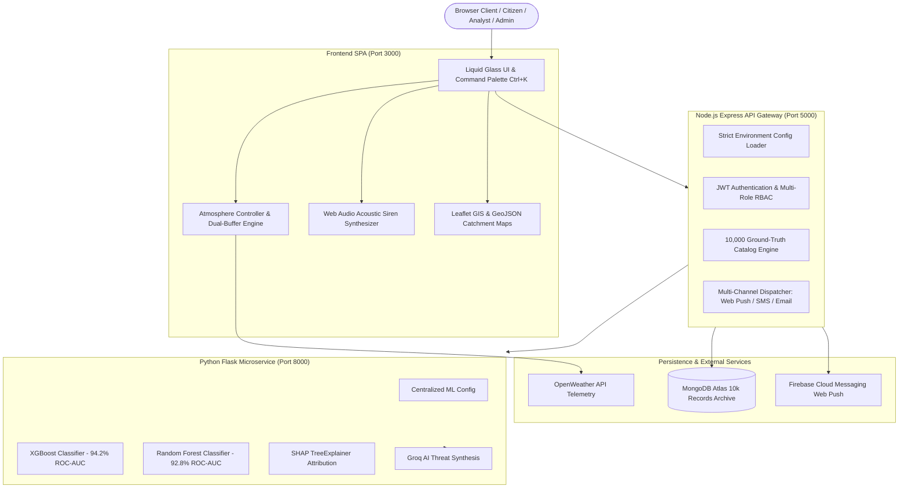

# FloodAI — AI Flood Prediction & Planetary Threat Intelligence Platform

[](.github/workflows/ci.yml)
[](scripts/validation/validate_secrets.js)
[](frontend/styles/glass.css)
[](frontend/js/services/climateBackgroundService.js)
[](dataset/README.md)
[](LICENSE)

**FloodAI** is an enterprise-grade disaster management, hydrological prediction, and early warning intelligence platform. It fuses dual machine learning classifiers (**XGBoost** + **Random Forest**), real-time **SHAP TreeExplainer** attribution, OpenWeather live telemetry, a **Liquid Glass** aesthetic with 12 cinematic environmental backgrounds, pure Web Audio acoustic civil defense sirens, and strict multi-persona Role-Based Access Control (RBAC).

---

## 🏛️ System Architecture



---

## ✨ Key Platform Features

### 1. Liquid Glass v2.6 & Dynamic Climate Backgrounds
- **12 Cinematic Atmospheric Environments**: High-resolution environmental photography for Clear Skies, Overcast Clouds, Drizzle, Torrential Rain, Severe Thunderstorm, Snow Flurries, Dense Fog, Gale Winds, Midnight Sky, Sunrise Dawn, Twilight Sunset, and Arid Heatwave.
- **Dual-Buffer Crossfade DOM Engine**: Zero-flash 1200ms cubic-bezier opacity crossfade between `#climateBgBufferA` and `#climateBgBufferB`, dynamically driven by live OpenWeather codes and solar phase transitions.
- **Canvas Particle Physics Engine**: Real-time ambient rainfall, thunderstorm lightning flashes, snow flurries, and heat shimmering with automatic Light/Dark theme color adaptation.

### 2. Multi-Role SaaS Workspaces & Strict RBAC
- **Resident Safety Hub** (`resident`, `user`):
  - Hyper-local flood susceptibility index and safe elevation margins.
  - Live precipitation telemetry and radar feeds.
  - Emergency advisories and local shelter locator.
  - Optional phone input with W3C SIM / Contact auto-fetch permissions.
- **Analyst Hydrologic Lab** (`analyst`):
  - 14-parameter ML simulation workbench (rainfall, river level, soil saturation, elevation).
  - SHAP TreeExplainer feature attribution vectors.
  - District risk comparison matrix across 10 monitored catchment sectors.
  - Model evaluation audit logs.
- **Admin Command Center** (`admin`):
  - Platform operations telemetry (compute, memory, API latency).
  - User administration, RBAC assignment, and session revocation.
  - System alert thresholds, rate limits, and webhook dispatch channels.
  - Searchable audit explorer and compliance trail.

### 3. Keyboard-Driven Navigation & Responsive Layout
- **Desktop Command Palette (<kbd>Ctrl+K</kbd> / <kbd>Cmd+K</kbd>)**:
  - Instant fuzzy search across accessible screens and operational actions.
  - **Strict Role Privacy**: Screens requiring higher roles are **never** displayed or mentioned to unauthorized users.
- **Mobile Responsive Drawer**:
  - Auto-configured drawer menu (☰) displaying accessible workspace modules on tablets and phones.
  - Bottom navigation bar with direct access to user persona home and GIS radar.

### 4. Acoustic Siren Synthesizer & Multi-Channel Dispatch
- **Web Audio API Multi-Voice Synthesizer**: Pure browser-generated acoustic warning sirens (Green Chime, Yellow Advisory, Orange Warning, Red Civil-Defense Air-Raid Siren) without external audio file dependencies.
- **Tri-Vector Dispatch Engine**: Firebase Web Push, Brevo SMTP municipal email bulletins, and telecom SMS gateway.

---

## 🔒 DevSecOps & Strict Secret Management

FloodAI enforces a **Zero-Secret Commit Policy**:
1. **No Tracked Credentials**: `.env`, `atlas-credentials.env`, `FIREBASE.JSON`, and private keys are strictly gitignored and verified by automated audit scripts.
2. **Centralized Fail-Fast Config Loaders**:
   - `backend/config/env.js`: Validates all environment variables at boot and fails fast in production without printing secret values.
   - `ml_model/config.py`: Loads environment configuration safely with zero hardcoded API key fallbacks.
3. **Automated Security Pipeline**:
   - `.github/workflows/security.yml`: Executes `validate_secrets.js` and `gitleaks` on every push and pull request.

---

## 🚀 Quick Start Guide

### Prerequisites
- Node.js >= 18.x (v20 LTS recommended)
- Python >= 3.9 (v3.10 recommended)
- MongoDB instance (Atlas or local)

### 1. Clone & Configure Environment
```bash
git clone https://github.com/your-org/flood-ai-project.git
cd flood-ai-project

# Copy environment templates
cp .env.example .env
cp backend/.env.example backend/.env
cp ml_model/.env.example ml_model/.env
```

### 2. Launch Services (Windows Quick Start)
```cmd
run_system.bat
```
To shut down all background services:
```cmd
stop_system.bat
```

### 3. Manual Service Launch
```bash
# Terminal 1: Python ML Microservice
cd ml_model
pip install -r requirements.txt
python predict_api.py # Runs on http://localhost:8000

# Terminal 2: Node.js Express Gateway
cd backend
npm install
npm run dev # Runs on http://localhost:5000

# Terminal 3: Frontend Client SPA
cd frontend
python -m http.server 3000 # Visit http://localhost:3000
```

---

## 🧪 Automated Verification Suites

Run the automated verification test suites from the project root using `npm` or `node`:

```bash
# Run all core verification suites via npm
npm test

# Or run suites individually:
# 1. DevSecOps Secret & Git Index Audit
npm run audit:secrets   # or: node scripts/validation/validate_secrets.js

# 2. Atmospheric Climate Engine Tests
node tests/test_climate_engine.js

# 3. Climate Background Assets & Crossfade Tests
node tests/test_climate_backgrounds.js

# 4. Light Theme Particle Physics Verification
node tests/test_light_theme_particles.js

# 5. Responsive Role Navigation & RBAC Tests
node tests/test_responsive_role_nav.js
```

---

## 📚 Documentation Reference

- [Architecture & Data Flow](docs/architecture.md)
- [Local Development Setup](docs/setup.md)
- [Environment Variables Guide](docs/environment-variables.md)
- [Cloud & Docker Deployment](docs/deployment.md)
- [Security Policy & Threat Defense](docs/security.md)
- [Contribution Guidelines](CONTRIBUTING.md)
- [Code of Conduct](CODE_OF_CONDUCT.md)
- [Security Disclosure Policy](SECURITY.md)

---

## 📄 License
This project is licensed under the [Apache License 2.0](LICENSE).
