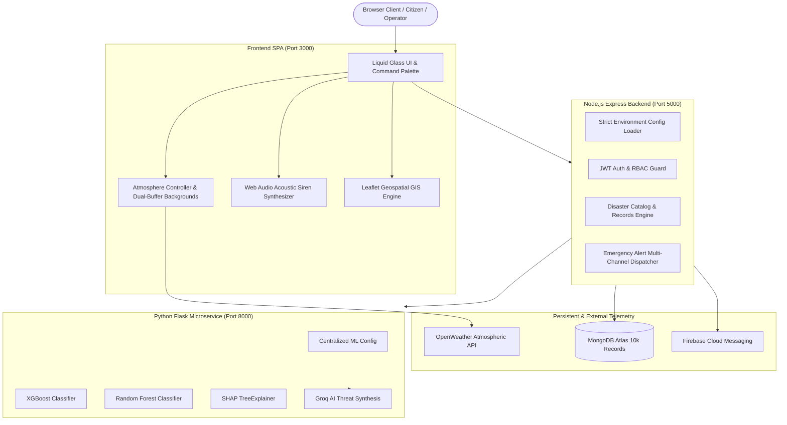

# FloodAI System Architecture

## 1. System Overview
FloodAI is a planetary-scale disaster threat intelligence platform that combines dual machine learning models (XGBoost & Random Forest), real-time atmospheric telemetry (OpenWeather API), geospatial GIS mapping (Leaflet), emergency acoustic siren synthesis (Web Audio API), and multi-channel civil defense dispatches (Web Push / SMS / Email).

## 2. Core Architectural Pillars

### A. Liquid Glass Design System & Atmospheric Canvas
- **Design Primitives**: Frosted translucent surfaces, fluid gradients, border scales, and responsive depth.
- **Dual-Buffer Atmospheric Backgrounds**: 12 cinematic environmental photography profiles crossfaded in the DOM with zero flashing, driven by live OpenWeather conditions.
- **Particle System**: Canvas-accelerated physics engine generating rain, snow, fog, thunderstorm lightning flashes, and heat shimmers with light/dark theme adaptation.

### B. Multi-Role SaaS Workspace Architecture
- **Resident Safety Hub**: Hyper-local flood susceptibility index, safe elevation margins, localized civil advisories, preparedness handbook, and saved bookmarks.
- **Analyst Hydrologic Lab**: Parameter simulation workbench, SHAP TreeExplainer feature attribution, 10-district risk matrix, and model evaluation log.
- **Admin Command Center**: Sensor telemetry, user directory & RBAC management, dynamic system configuration, alert operations, and audit explorer.
- **Navigation Model**:
  - Desktop: Sidebar + Command Palette (<kbd>Ctrl+K</kbd> / <kbd>Cmd+K</kbd>) with role-filtered search.
  - Mobile: Clean menubar + Slide-out drawer menu.

### C. Machine Learning Inference Pipeline
- **Dual Models**:
  - XGBoost Classifier (ROC-AUC 94.2%)
  - Random Forest Classifier (ROC-AUC 92.8%)
- **Feature Set**: 14 hydrological and topographic factors including rainfall (24h/72h), river stage, soil saturation, elevation, drainage capacity, and coastal proximity.
- **SHAP Attribution**: Exact feature contribution analysis identifying positive and negative flood vulnerability drivers.
- **AI Synthesis**: Groq LLM generating human-readable civil defense advisories with local rule-based fallback.

### D. Emergency Siren & Warning Dispatch
- **Acoustic Synthesizer**: Pure Web Audio API dual-oscillator synthesizer generating standard civil-defense alert tones (Green chime, Yellow advisory, Orange warning, Red high-intensity air-raid siren).
- **Multi-Channel Dispatch**: Firebase Cloud Messaging (Web Push), Brevo (SMTP bulletins), and Twilio (SMS).
