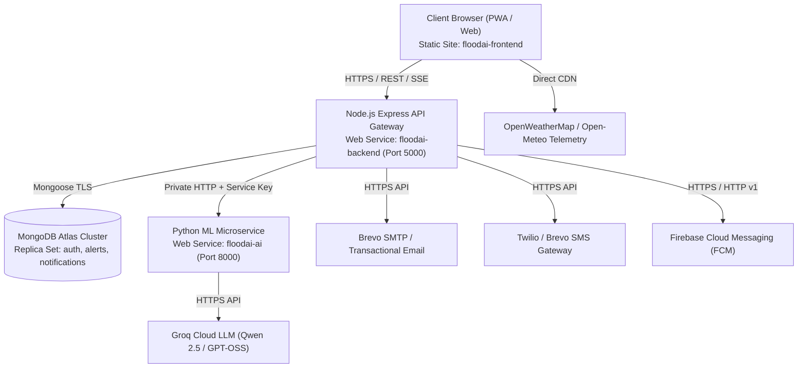

# FloodAI — Production Deployment Guide for Render

## 1. System Architecture Overview

FloodAI deploys on **Render** as a 3-tier distributed microservice architecture:



---

## 2. Render Services Catalog

| Service Name | Render Type | Runtime | Directory | Start Command | Health Check |
|---|---|---|---|---|---|
| `floodai-ai` | Web Service | Python 3.10 | `ml_model` | `gunicorn predict_api:app --bind 0.0.0.0:$PORT --workers 2 --timeout 120` | `/health` |
| `floodai-backend` | Web Service | Node 18+ | `backend` | `npm start` | `/api/health` |
| `floodai-frontend` | Static Site | HTML/CSS/JS | `frontend` | Static Publish (`.`) | `/` |

---

## 3. Environment Variables Catalog

### 3.1 `floodai-ai` (Python Microservice)

| Variable | Type | Description | Production Example |
|---|---|---|---|
| `PYTHON_VERSION` | Plaintext | Python runtime version | `3.10.12` |
| `PORT` | Plaintext | Port assigned by Render | `8000` |
| `INTERNAL_SERVICE_SECRET` | Generated Secret | Service-to-service auth key | Auto-generated 32-byte hex |
| `STRICT_INTERNAL_AUTH` | Boolean | Enforce internal key verification | `true` |
| `GROQ_API_KEY2` | Secret | Groq Cloud API key for threat synthesis | `gsk_...` |

### 3.2 `floodai-backend` (Node.js Gateway)

| Variable | Type | Description | Production Example |
|---|---|---|---|
| `NODE_ENV` | Plaintext | Runtime environment | `production` |
| `PORT` | Plaintext | Port assigned by Render | `5000` |
| `MONGODB_URI` | Secret | MongoDB Atlas connection string | `mongodb+srv://<username>:<password>@cluster0.example.mongodb.net/flood_prediction` |
| `JWT_SECRET` | Generated Secret | Secret key for JWT signing | Auto-generated 64-byte hex |
| `ML_API_URL` | Cross-Service | Hostname of ML service | `http://floodai-ai:8000` (Render Private Network) |
| `INTERNAL_SERVICE_SECRET` | Cross-Service | Synced with `floodai-ai` key | Synced via Render Blueprint |
| `CORS_ORIGIN` | Cross-Service | Allowed frontend origin | `https://floodai-frontend.onrender.com` |
| `BREVO_API_KEY` | Secret | Transactional email API key | `xkeysib-...` |
| `BREVO_SENDER_EMAIL` | Plaintext | Verified sender address | `alerts@floodai.org` |
| `FIREBASE_PROJECT_ID` | Plaintext | FCM project ID | `floodai-24a0f` |
| `FIREBASE_SERVER_KEY` | Secret | Legacy FCM server key | `AAAA...` |
| `OPENWEATHER_API_KEY` | Secret | OpenWeatherMap API key | `4a...` |

---

## 4. Pre-Deployment Configuration Steps

### Step 1: MongoDB Atlas Network Access
Because Render dynamic web services run on pooled egress IPs, you must allow Atlas connections from Render:
1. Log into [MongoDB Atlas](https://cloud.mongodb.com).
2. Go to **Network Access** > **IP Access List**.
3. Click **Add IP Address** > Select **Allow Access from Anywhere** (`0.0.0.0/0`).
4. Ensure the database user assigned in `MONGODB_URI` has `readWrite` permissions on database `flood_prediction`.

### Step 2: Push Repository to GitHub / GitLab
Ensure all changes, including `render.yaml`, `dataset/`, `ml_model/`, `backend/`, and `frontend/`, are committed and pushed to your remote repository.

### Step 3: Deploy via Render Blueprint
1. Open [Render Dashboard](https://dashboard.render.com).
2. Click **New +** > **Blueprint**.
3. Connect your GitHub/GitLab repository.
4. Render will parse [render.yaml](file:///o:/flood-ai-project/render.yaml) and display the 3 services:
   - `floodai-ai`
   - `floodai-backend`
   - `floodai-frontend`
5. Fill in the required secrets marked `sync: false`:
   - `MONGODB_URI`
   - `GROQ_API_KEY2`
   - `BREVO_API_KEY` (optional for live email)
   - `FIREBASE_SERVER_KEY` (optional for live push)
6. Click **Apply Blueprint**.

---

## 5. Deployment Verification & Smoke Testing

Once deployment completes, perform the following verification checks:

1. **ML Microservice Health:**
   ```bash
   curl -I https://floodai-ai.onrender.com/health
   # Expected: HTTP/2 200 OK {"status":"healthy"}
   ```

2. **Backend API Health:**
   ```bash
   curl -I https://floodai-backend.onrender.com/api/health
   # Expected: HTTP/2 200 OK {"status":"healthy","database":"connected"}
   ```

3. **Frontend Application:**
   Navigate to `https://floodai-frontend.onrender.com`.
   - Verify Liquid Glass theme renders with custom bathymetric background.
   - Verify Geolocation widget prompts or defaults to district selector.
   - Sign in using an administrative or analyst account.
   - Run AI threat prediction in the AI Risk Lab and verify SHAP breakdown.
   - Trigger SOS Emergency button and verify confirmation modal.

---

## 6. Troubleshooting & Operational Runbook

| Symptom | Probable Cause | Remediation |
|---|---|---|
| `MongooseServerSelectionError` | MongoDB Atlas IP whitelist blocking Render | Add `0.0.0.0/0` to Atlas Network Access IP List. |
| `401 Unauthorized` between Backend and ML | `INTERNAL_SERVICE_SECRET` mismatch | Verify Render blueprint correctly mapped `fromService.envVarKey`. |
| `CORS Error` on frontend API calls | `CORS_ORIGIN` missing or mismatched | Set `CORS_ORIGIN` to exact frontend domain on `floodai-backend`. |
| ML Microservice memory limits | Free tier 512MB RAM cap exceeded | Use Gunicorn `--workers 2` (configured in blueprint). |
